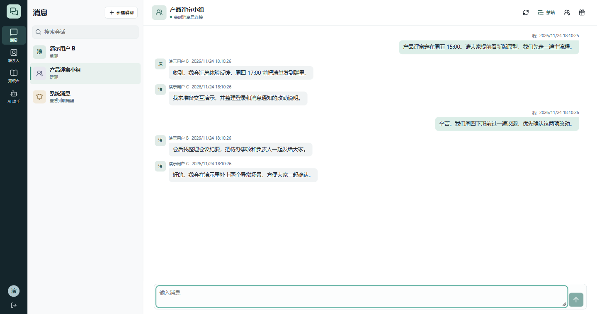
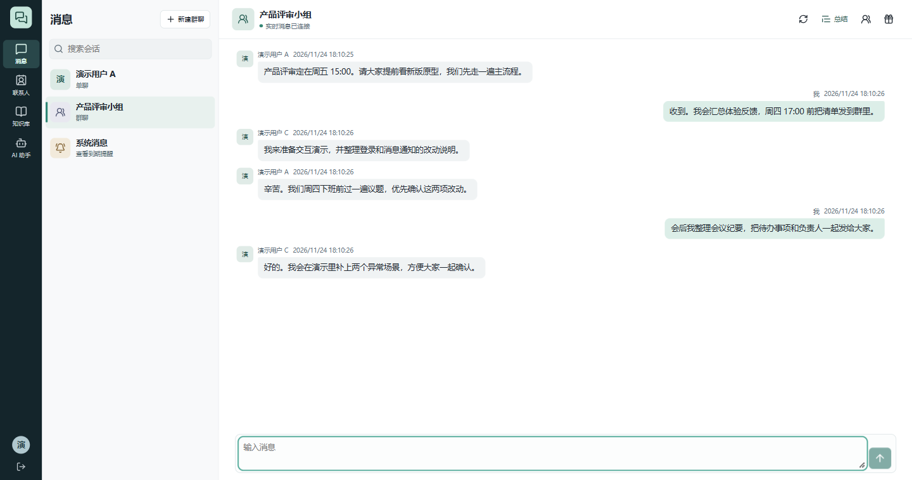
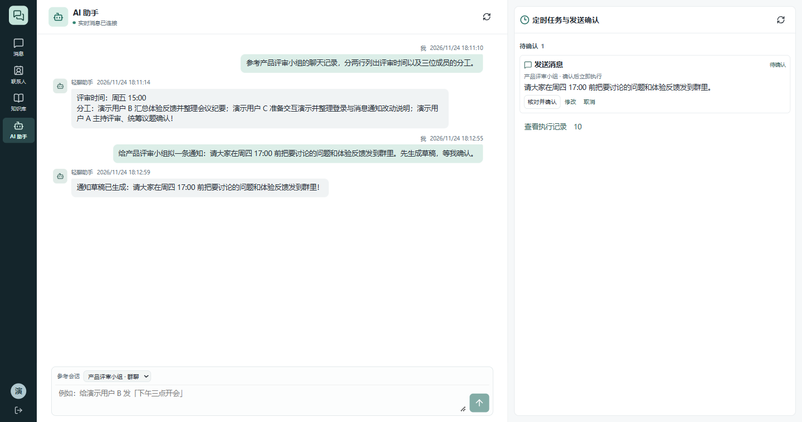

# 轻聊 IM

轻聊是一个面向小团队的即时通讯和协作应用，把聊天、共享资料和待办任务放在同一个工作区。

- **即时通讯**支持添加联系人、创建群聊和实时收发消息。可以翻阅历史、总结近期对话，也可以用站内余额发红包。
- 在**会话知识库**中，可以上传个人资料或把文件共享到指定会话。查询时按访问权限检索，回答附带使用的资料来源。
- 使用 **AI 协作助手**时，可以选择一段单聊或群聊作为参考，用自然语言拟写消息、邮件或安排提醒。发送草稿由用户核对确认，到期提醒在「系统消息」中查看。

## 界面截图

### 三人群聊



<details>
<summary>查看演示用户 B 的视角</summary>



</details>

### AI 助手



## 本地运行

页面使用 Vue 3，Maven 打包时会一并构建前端。

需要 JDK 17、Maven、Node.js 22.18+ 和本机 WSL Docker。以下命令在包含父 `pom.xml` 的轻聊工程目录执行。

```powershell
./tools/start-local.ps1 -StartMiddleware -Build
```

打开 [本机应用](http://localhost:10010/)。启动脚本读取本工程 `.env`，保留已有本机数据卷，并补齐任务和知识库所需的数据库表。关闭运行脚本的终端可停止本轮启动的应用。

在本机 `.env` 配好 `DASHSCOPE_API_KEY` 后，可以启用真实模型；需要联网搜索时，同时填 `BIGMODEL_API_KEY` 并加 `-Mcp`。

在左侧打开「AI 助手」，用输入框上方的「参考会话」选择单聊或群聊。助手可按需读取该会话的历史消息和已共享的资料，普通会话的参考范围由成员权限决定。

```powershell
./tools/start-local.ps1 -StartMiddleware -Models -Mcp
```

邮箱验证码需要 SMTP 服务器地址、端口、邮箱和授权码。TLS 邮箱使用 `SPRING_MAIL_SSL_ENABLED=true` 时，应配置对应的 SSL 端口。详见[部署说明](deploy/README.md)。

## 工程文档

- [部署说明](deploy/README.md)包含服务启动和配置。
- [数据库初始化说明](database/README.md)记录迁移和演示数据的位置。
