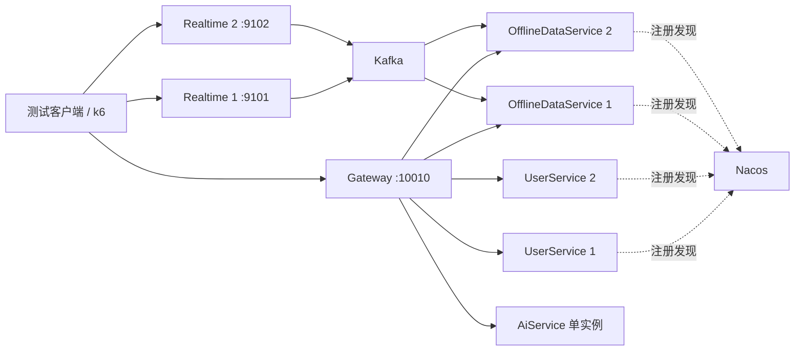

# 09：多实例部署、真实联调与压测

[返回导航](00-学习导航.md) · [单实例启动说明](../../deploy/README.md)

## 本篇目标

把现有工程从“一种服务一个进程”扩成可观察、可对比的多实例环境，先验证正确性，再测容量。2026-11-17 检查时，本机仍没有可用 Docker、k6 命令；本文新增配置与脚本经过静态检查，不代表容器、压测已实际运行，也没有任何可报告的性能数值。

## 一、微服务和多实例在这个项目里分别指什么

UserService、OfflineDataService、RealTimeService、RedPacketService、AiService、GateWay 是不同服务；给同一种服务多启动几个进程才是多实例。可以先在同一台机器的 Docker 网络内验证，之后再考虑多机器部署。



图中未展开共享 MySQL、Redis、PgVector、MinIO；应用副本共用这些基础设施。当前方案是应用多实例实验，MySQL、Redis、Kafka、Nacos 仍单节点，不是整套高可用集群。单机多进程也不能证明跨机器容灾。

### 当前最适合先扩哪些服务

| 服务 | 本文实例数 | 扩容需要注意什么 |
|---|---:|---|
| UserService | 2 | Nacos 发现、相同 JWT/内部凭证、不同雪花 worker；注册/联系人并发要另做一致性验证 |
| OfflineDataService | 2 | 相同存储消费组分摊分区；不要每节点各写一份；Canal 先关闭 |
| RealTimeService | 2 | 不同节点 ID、worker、可访问 WS 地址；每节点独立推送组 |
| Gateway | 1 | 两个业务实例并不要求两个网关；网关多实例还需统一入口及端口方案 |
| RedPacketService | 1 | 基础消息测试完成后再单独扩，验证唯一领取、余额及退款一致性 |
| AiService | 先 1 | HTTP 调用可走发现，但 Redis 共享记忆不等于同会话并发安全；多实例还有工具副作用、文档文件共享与模型限额问题 |

### 三个不能直接复制的配置

1. `SNOWFLAKE_WORKER_ID`：同一 datacenter 内各进程使用不同 worker，避免不同进程生成重复 ID。当前实现使用 Hutool Snowflake，配置规模还受其 ID 位数限制。
2. `CHAT_NODE_ID`：实时节点必须不同；推送组名包含节点 ID。相同 ID 会让两个节点共享消费组，消息可能只分给没有目标连接的节点。
3. `ws-host/ws-port`：Nacos 注册的是 HTTP 地址；登录返回的 WS 地址必须能被测试客户端访问。[NettyServiceLocator](../../UserService/src/main/java/cn/qingliao/userservice/loadbalancer/NettyServiceLocator.java) 读取元数据生成该地址。

不要直接 `--scale realtimeservice=2`：现有配置有固定宿主端口和固定 worker。本文采用显式第二实例配置，端口与身份可检查。Compose 的端口和扩容规则参考 [Docker 官方说明](https://docs.docker.com/compose/how-tos/networking/)。

## 二、启动两组实例

以下 PowerShell 命令在 IM 父 pom.xml 所在目录执行。先使用本机隔离测试环境和现有演示数据，不把测试账号导入真实业务库。

### 1. 准备和构建

```powershell
./tools/prepare-env.ps1
./tools/verify.ps1 -Package
```

首次初始化、已有 MySQL 卷的升级规则见[数据库说明](../../database/README.md)。尤其已有卷需要具备 Nacos 数据库和对应用户，不能只启动 Nacos 就认为发现可用。

### 2. 固定本轮 Compose 文件组合

```powershell
$composeArgs = @('--env-file', '.env', '-f', 'deploy/compose.yml', '-f', 'deploy/compose-discovery.yml', '-f', 'deploy/compose-multi.yml', '--profile', 'apps', '--profile', 'discovery')
docker compose @composeArgs config --quiet
docker compose @composeArgs up -d mysql redis zookeeper kafka minio nacos
docker compose @composeArgs ps
docker compose @composeArgs logs --tail 80 nacos
```

先确认 MySQL、Redis、Kafka 就绪，Nacos 无数据库连接错误，再启动应用：

```powershell
docker compose @composeArgs up -d --build
docker compose @composeArgs ps
docker compose @composeArgs logs --tail 100 userservice userservice-2 realtimeservice realtimeservice-2
./tools/smoke-api.ps1
```

[新增 overlay](../../deploy/compose-multi.yml) 需放在基础配置和 discovery 配置后。环境默认绑定本机回环地址；Nacos、数据层和密钥沿用 `.env`，不输出 `config` 展开结果以免把凭证打印出来。

| 实例 | worker | HTTP 容器端口 | 对客户端开放的 WS 端口 |
|---|---:|---:|---:|
| userservice / userservice-2 | 1 / 7 | 都为 8104，容器 IP 不同 | — |
| offlinedataservice / offlinedataservice-2 | 4 / 9 | 都为 8101，容器 IP 不同 | — |
| realtimeservice / realtimeservice-2 | 2 / 8 | 都为 8102，容器 IP 不同 | 9101 / 9102 |

第二实时节点将内部 Netty 端口也设为 9102，使注册地址、监听端口、宿主映射一致，不需要改 Java。UserService 使用一致性哈希选实时节点；重复登录同一账号不会轮流返回两个节点。

如果所有客户端都在本机，`NETTY_ADVERTISED_HOST=localhost` 即可。部署到服务器时，基础文件改为 `deploy/compose-server.yml`；在 `.env` 配置客户端可达的 `NETTY_ADVERTISED_HOST`，并增加 `CHAT_BIND_IP=0.0.0.0`，开放 WS 9101/9102 和网关 10010。客户端在另一台机器时 localhost 指向客户端自己，不能照抄。

该组合依赖同一个 Compose 网络，不能把文件分别拿到两台服务器启动就当作跨机器部署：还需改基础设施地址、Nacos 注册 IP、Kafka advertised listeners、共享存储和网络连通。多台机器的后续方案可选 Docker 编排或 Kubernetes，先完成本机验证再引入。

## 三、先做真实联调，确认多实例工作了

### 1. 注册与路由

- Nacos 应显示 UserService、OfflineDataService、RealTimeService 各两个健康实例，应用名相同、实例地址不同。
- 检查 discovery overlay 是否生效：Feign 的固定 URL 为空，Gateway 使用 `lb://`；仅把服务注册到 Nacos，并不自动改掉固定 URL。
- 连续通过网关查询历史消息，对照两个 Offline 服务日志中的请求记录。不能只看容器数量就判断已经负载均衡。
- Kafka 使用 `store-topic` 的同一存储组分摊任务，推送则是 `infinite-chat-push-realtimeservice-1` 和 `...-2` 两个组。当前 store/push/AI Topic 配置为 3 分区、1 副本；同组消费者超过分区数不增加有效分区并行度。单个热门 session 的 key 固定，也不会被均匀打散到所有分区。

### 2. 跨节点聊天

用演示账号 A=1001、B=2002 登录。先按返回的 nettyUri 连接；为明确验证跨节点，也可以让 A 使用自身 Token 连接 9101、B 使用自身 Token 连接 9102。测试客户端需要支持 `Authorization: Bearer ...` 握手头；原生浏览器 WebSocket 不能直接设置该头。

A 发：

```json
{"sessionId":"99001","sessionType":0,"receiverId":"2002","type":0,"clientMessageId":"multi-node-001","content":"cross-node test"}
```

核对 A 回显、B 接收具有同一个 messageId；稍后历史查询能查到，数据库该 ID 只一条。再断开 B、由 A 发消息，B 重新登录并调用离线补拉。调用方法见[启动说明](../../deploy/README.md)。不能只用 ping/pong 证明消息落库和跨节点推送。

### 3. 副本故障

在有请求时执行 `docker compose @composeArgs stop offlinedataservice-2`，观察注册摘除前后的失败、恢复时间与另一实例消费。恢复用 `start offlinedataservice-2`。再单独停止一个实时节点：该节点连接会断，客户端必须重新登录/取节点地址并重连，不会自动迁移既有 TCP 连接。基础客户端自动重连尚未完整实现。

跨节点并发重连还可能残留旧节点连接，当前本 JVM 的连接替换不等于全局强制单连接。故障恢复应检查重复推送、漏显示和补拉结果，不仅检查进程重启。

### 4. 红包与 AI 分别验收

红包：重复领取、并发领取、领完/过期竞争、退款重试；对比领取唯一记录、余额增减和流水，不以接口返回成功当作已入账。只使用测试余额。

AI：先一个账号连续对话，确认会话记忆；再用已导入文档的可核对问题验证 RAG；然后检查工具参数与执行结果。通过固定 AI 消费组，单条请求应由一个消费者处理，但模型调用后缓存前失败仍可能重调。

## 四、压测分开测，不用一个数字概括全部能力

| 测试 | 测什么 | 核心观察 |
|---|---|---|
| HTTP 历史查询 | 网关、鉴权、授权 RPC、Redis/MySQL 查询的整体耗时 | 业务成功率、请求率、P95/P99、MySQL 查询量、缓存分支 |
| WS 连接保持 | 握手、连接资源与应用心跳 | 成功连接数、提前断开比例、ping/pong 延迟、内存与 FD |
| 聊天消息负载 | WS → Kafka → 两端接收与持久化 | 发送消息率、接收率、端到端延迟、丢重消息、消费积压 |
| AI 请求负载 | 模型、检索、工具与并发限制 | 完整响应时间、流式首 Token 时间、限流/超时、Token 消耗、任务正确性 |

本次提供前两类脚本；聊天消息压测和 AI 压测未伪装成已自动化。消息压测需按会话配对用户，记录唯一 clientMessageId 和发送时间，在接收端关联消息 ID、算接收延迟、超时和重复，再核对持久化。`ws-idle.js` 只测连接与心跳，不能产出消息吞吐或送达率。

### 1. 历史查询脚本

安装 k6 后，在工程根目录：

```powershell
New-Item -ItemType Directory -Force load-results | Out-Null
k6 run -e BASE_URL=http://localhost:10010 -e VUS=10 --summary-export=load-results/history-10.json tools/load/history.js
```

[history.js](../../tools/load/history.js) 在 setup 登录一次，之后复用 Token 发查询；不重复压登录接口。它同时检查 HTTP 状态与响应内的业务 code，HTTP 200 但业务失败也计失败。不要在测试时另行登录同一账号覆盖 Token。

默认逐步爬升、保持、退出，带 0.2 秒思考时间，属于封闭并发模型；10 VU 不是固定 10 QPS。需要固定到达率时另配 arrival-rate executor，并观察 dropped_iterations。默认 P95<500ms、P99<1000ms 和成功率>99% 只是可修改的验收线，不是项目已达到的结果。k6 的阈值可决定进程是否以失败退出，见[官方说明](https://grafana.com/docs/k6/latest/using-k6/thresholds/)。

测之前先发至少 40 条不同时间的消息，使查询有足够数据；记录数据量、请求窗口是否稳定、Redis 是否足够一页。空表、热缓存命中和缓存不足回源是三种不同负载，不能混报。比较配置时使用同一数据快照；不要对共享 Redis 执行 FLUSHDB 来制造冷缓存。

### 2. WebSocket 连接脚本

先用现有两个演示账号验证脚本：

```powershell
k6 run -e BASE_URL=http://localhost:10010 -e VUS=2 -e HOLD_SECONDS=60 --summary-export=load-results/ws-2.json tools/load/ws-idle.js
```

[ws-idle.js](../../tools/load/ws-idle.js) 每个 VU 使用不同账号、只建一条连接，按登录返回地址连接；用文本 `ping`/`pong` 匹配当前服务心跳协议。不能让 1000 个 VU 用同一账号：当前凭证覆盖和本机连接替换会干扰结果。

需要更多账号时，先生成数据，脚本不会自动执行 SQL：

```powershell
python tools/load/make-accounts.py --count 100
```

用数据库客户端选择当前实验服务连接的独立测试库，再执行 `deploy/generated/load/accounts.sql`。脚本不含 USE，不自动选择数据库。其固定 ID 从 5000000 起、邮箱为 load-xxxxx@example.invalid，仅适用于预留此编号范围的测试库；不覆盖冲突行，因此存在冲突时应换干净测试库，不假定旧账号会变成新密码。该数据只创建连接测试用户，不创建好友、会话和余额，不能直接用于聊天/红包压测。

```powershell
k6 run -e BASE_URL=http://localhost:10010 -e VUS=100 -e HOLD_SECONDS=180 -e ACCOUNTS=../../deploy/generated/load/accounts.json --summary-export=load-results/ws-100.json tools/load/ws-idle.js
```

ACCOUNTS 按脚本文件所在目录解析。setup 顺序登录，连接阶段才同时保持连接，故这不是并发登录压测。脚本使用 k6 的 [WebSocket 接口](https://grafana.com/docs/k6/latest/javascript-api/k6-ws/connect/)，自定义握手头携带凭证。生成的数据与结果不提交版本库，结果文件默认不包含 Token。

### 3. 对照实验与阶梯

先以 2 人联调通过，再测 10、25、50 等逐级负载，观察稳定后再加，不一开始就建几万连接。先运行基础＋discovery 文件作为单实例基线，再用相同数据、压测机和时长叠加 multi 文件对照。每次保留预热、稳定阶段和停止后的积压消退记录；不要直接把包含启动/爬升阶段的总分位数说成稳定阶段分位数。

为防先前多实例容器残留，做单实例对照前，明确停止第二实例：`docker compose @composeArgs stop userservice-2 offlinedataservice-2 realtimeservice-2`，不要仅改变命令文件组合后假定旧容器会自动消失。

连接数、请求率、消息吞吐是不同指标。最终报告写“在指定硬件、版本、数据量、请求模型和成功率约束下的结果”。压测机尽量与服务端分离，否则同机 CPU/网络争抢会影响结论；若同机测试就明确注明。

## 五、观察哪些指标，以及当前观测还缺什么

1. `docker stats`：逐容器 CPU、内存、网络与进程数，同时观察测试机资源。容器内 JVM 可用 `jcmd`/JFR 等另行采集，但当前镜像是 JRE 时不一定含这些工具。
2. Kafka consumer group：用 kafka-consumer-groups 工具查看 store 组和 AI 组 lag、分区分配；检查停止副本后分区是否转移。取实际 group 名，不把推送的每节点组误当存储共享组。
3. MySQL：连接数、慢查询、锁等待、消息表唯一记录与领取/流水账核对。Redis：内存、连接、慢命令、命中/回源相关调用；整体命中率不能直接代表本历史接口命中率。
4. 应用请求和错误日志：认证、授权 RPC、Kafka 发布错误、推送异步失败、模型限流/超时，按消息 ID 或本次测试前缀关联。
5. [现有 Prometheus 配置](../../deploy/prometheus.yml) 只抓 AiService；Grafana 10 面板主要是模型指标，并没有全服务、Kafka/Redis/MySQL exporter 的完整监控。需要采集这些指标时要扩展抓取目标/组件，不能启动 Grafana 就说整套压测监控齐备。HTTP/WS 的基线结果先以 k6、容器指标和日志交叉验证。

AI 压测先限制到 1—2 个并发，以已知输入、固定文档和工具场景分别测，记录请求与 Token 成本。流式首 Token 时间需在客户端收到首个内容时单独打点，不能拿现有完整请求 Timer 代替。当前同会话多请求没有分布式串行保证，先不同 session 并发，再单独验证同 session 并发；邮件等有副作用工具只对测试地址执行。

## 六、结果记录模板

| 项目 | 实测填写 |
|---|---|
| 日期 / 代码版本 / 环境 | 时间、提交或代码快照、硬件、Docker/JDK 版本 |
| 部署 | 各服务副本数、JVM 限额、worker、Kafka 分区及副本数 |
| 数据 | 用户/会话/消息量、是否热缓存、是否启用 Canal/AI |
| 负载 | k6 脚本、VU/到达率、时长、思考时间、压测机位置 |
| 结果 | 业务成功率、请求率、P95/P99、连接保持成功率 |
| 一致性 | 同 ID 落库、重复消息、余额/流水、故障后补拉 |
| 资源与积压 | 各容器 CPU/内存、MySQL 连接/慢查、Kafka lag |
| 结论 | 瓶颈和证据、下一次只改哪个变量；未测项明确列出 |

停止实验：`docker compose @composeArgs down`，不加 `-v`。这会停止本项目实验容器并保留数据卷。

## 本篇自查

1. 两个实时实例为什么不能共用 CHAT_NODE_ID 和固定 worker？
2. 一个历史查询 HTTP 200，能否算压测成功？
3. WS 保持 1000 连接，能否证明每秒可发送 1000 条且全部落库？
4. 为什么本文先不复制两个 AiService 并宣称可线性扩容？

## 自查解答

1. 前者影响每节点推送消费组，后者影响跨进程消息 ID 唯一性；还需要不同或正确映射的 WS 地址。
2. 不能。还要业务 code=200、响应结构正确，测试数据与查询范围有意义，并满足预先约定的耗时和成功率条件。
3. 不能。连接保持只验证连接及心跳，消息负载还需两端关联接收、延迟与持久化核对。
4. 共享记忆没有自动解决同会话并发覆盖，知识文件还在本地，工具副作用和模型额度也是约束；先测单实例再验证这些问题。
